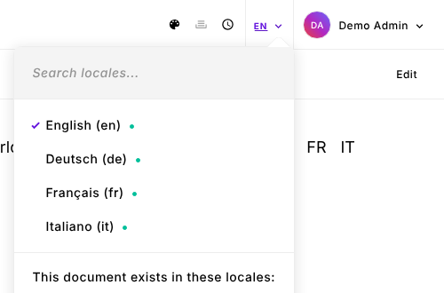

# Installation guide

For administrators: how to add Supertext Translation to an ApostropheCMS site, set up the API key and the languages, and what every setting does. Editors: see the [user guide](USER_GUIDE.md).

## What it does

The module registers Supertext as a **translation provider** for Apostrophe's own *Localize…* step (Apostrophe's `@apostrophecms/translation` module). When an editor localizes a page or piece into other locales and ticks **Translate text content**, every copy is translated by Supertext AI before Apostrophe saves it as a draft. Nothing else in the editing workflow changes. Administrators also get a **Supertext** status screen in the admin bar, and there are two command-line tasks (`check` and `translate`).

## Requirements

- ApostropheCMS 4.13 or later (tested with 4.33), with MongoDB, PostgreSQL or SQLite.
- Node.js 22.12 or later.
- At least two locales configured in `@apostrophecms/i18n` (see [Languages](#languages)).
- A Supertext account and an API key for the AI translation API:
  - No Supertext account yet? Create one at supertext.com: <https://www.supertext.com/person/en/account/signin>
  - Generate your API key at supertext.com → Integrations → API (requires the **Admin** role): <https://www.supertext.com/en/integrations/api>
- The server must reach `https://api.supertext.com` over HTTPS (and, for [Translation review](#translation-review), Supertext's review service `https://localizationreview-production.up.railway.app`).

## Install

1. Add the package to your Apostrophe project:

   ```bash
   npm install supertext-apostrophe-translation
   ```

   (Until it is published on npm, install it from GitHub: `npm install github:Supertext/Apostrophe-Supertext-Translation`.)

2. Enable the module in `app.js`:

   ```js
   apostrophe({
     shortName: 'my-site',
     modules: {
       // …
       'supertext-apostrophe-translation': {}
     }
   });
   ```

   Choose each locale's Supertext language afterwards on the Supertext screen (see [Languages](#languages)).

3. Set the API key as an environment variable (see [API key](#api-key)) and restart Apostrophe.

4. Rebuild the admin UI assets once (the module adds a Vue component and UI strings). In development Apostrophe does this on start; for production run your usual build, e.g. `node app @apostrophecms/asset:build` (or `npm run build` in the starter kits).

5. Check the connection:

   ```bash
   node app supertext-apostrophe-translation:check
   ```

   It prints the module version, the API address and `Connected. The API key works.` (No translation is made, so this costs nothing.)

## Update

```bash
npm update supertext-apostrophe-translation
```

Then rebuild the assets and restart. The version is shown on the Supertext status screen and by the `check` task. Read the [changelog](../CHANGELOG.md) before updating.

## Uninstall

Remove `'supertext-apostrophe-translation'` from `app.js`, run `npm uninstall supertext-apostrophe-translation`, rebuild the assets and restart. Localized documents it translated stay as they are. The only thing the module stores is the state of its version reports and API key check: one entry in Apostrophe's cache collection (`aposCache`, namespace `supertext-apostrophe-translation`, key `reporter`). To remove it too: `db.aposCache.deleteOne({ namespace: 'supertext-apostrophe-translation', key: 'reporter' })` (MongoDB) or delete that row.

## API key

The module reads the key from, in this order:

1. the environment variable `SUPERTEXT_API_KEY` (recommended: keeps the key out of your code), or
2. the module option `apiKey`.

Paste the key as Supertext shows it: with or without the `Supertext-Auth-Key ` prefix.

No Supertext account yet? Create one at supertext.com (<https://www.supertext.com/person/en/account/signin>). Generate your API key at supertext.com → Integrations → API (requires the Admin role): <https://www.supertext.com/en/integrations/api>.

Without a key, the module stays inactive: the *Translate text content* option doesn't appear in the *Localize…* wizard, the status screen says the key is missing, and Apostrophe logs a warning with both links when it starts.

## Languages

Apostrophe's locales are set in `modules/@apostrophecms/i18n/index.js` of your project. The module translates between all of them, from the locale the editor localizes from:

```js
// modules/@apostrophecms/i18n/index.js
export default {
  options: {
    defaultLocale: 'en',
    // Optional: slugs without accents (fabrique-a-la-main instead of fabriqué-à-la-main)
    stripUrlAccents: true,
    locales: {
      en: { label: 'English' },
      de: { label: 'Deutsch', prefix: '/de' },
      fr: { label: 'Français', prefix: '/fr' },
      it: { label: 'Italiano', prefix: '/it' }
    }
  }
};
```

Every locale needs a **Supertext language**. Administrators choose it in the admin bar under **Supertext → Languages**: one combo box per locale (all of the site's locales, the default locale included, because the same code is used when the locale is the source; as source, only its language is sent: `de-CH` → `de`). The combo box lists Supertext's target languages as *Name (code)*, the names in your interface language. Where Supertext offers formal and informal address for the chosen language (e.g. German, French, Italian, Spanish, Dutch, not English), a second combo box sets the **form of address**: *Default*, *Formal* or *Informal*. The checkbox **Translation review** sends translations into that locale through Supertext's review service (off by default; see [Translation review](#translation-review)). Click **Save languages**; the choice is stored in the database (Apostrophe's cache collection, without expiry) and applies at once, without a restart.


The code used for a locale:

1. the code saved on the Supertext screen (or set by the module option `languages`, which overrides the screen), else
2. the locale name, if it is exactly one of Supertext's codes (case and `_`/`-` don't matter: `de_ch` = `de-CH`), else
3. the default for the locale name, where one is obvious (see the table), else
4. nothing: the locale is **unsupported**. Apostrophe's *Localize…* wizard then says automatic translation isn't available for it, and nothing is sent to Supertext.

A combo box without a saved choice preselects the exact match or the default (marked *Default, not saved yet*); a locale with neither (e.g. `en-IE`, `de-LI`, `fr-BE`, `gsw`, `sr-RS`, `no`) shows *— choose —* and stays unsupported until you choose a language.

| Locale name | Default Supertext language |
| --- | --- |
| `de`, `en`, `fr`, `it`, `pt` | `de-DE`, `en-US`, `fr-FR`, `it-IT`, `pt-PT` |
| `zh`, `zh-CN`, `zh-SG` / `zh-TW`, `zh-HK`, `zh-MO` | `zh-Hans` / `zh-Hant` |
| `sr`, `sr-Latn-RS` / `sr-Cyrl-RS` | `sr-Latn` / `sr-Cyrl` |
| A region of a language Supertext offers without region (`es-ES`, `es-419`, `nl-NL`, `nb-NO`) | the language (`es`, `nl`, `nb`) |
| Anything else without an exact match (`en-IE`, `de-LI`, `de-AT`, `fr-BE`, `gsw`, `no`) | none: choose one |

Supertext's codes: target languages are regional only for German, English, French, Italian and Portuguese (`de-CH`, `de-DE`, `en-GB`, `en-US`, `fr-CH`, `fr-FR`, `it-CH`, `it-IT`, `pt-BR`, `pt-PT`), with a script for Chinese and Serbian (`zh-Hans`, `zh-Hant`, `sr-Latn`, `sr-Cyrl`), `gsw-u-sd-chzh` / `gsw-u-sd-chbe` for Swiss German dialects, and bare for all others (`es`, `nl`, `sl`, `ja`, …). Source languages are bare (`en`, `de`). The server accepts only these codes when you save.

**Override for automated setups.** The module option `languages` sets locales in code; a locale listed there wins over the screen, whose combo boxes for it are then read-only and say *Set by the module option languages*. Codes in the option are sent as they are (the screen marks one Supertext doesn't list).

```js
// app.js
'supertext-apostrophe-translation': {
  options: {
    languages: {
      de: { code: 'de-CH', politeness: 'more' },   // Swiss German, formal (Sie)
      it: 'it-CH',                                 // short form: just the code
      fr: { review: true }                         // only Translation review, the code from the screen
    }
  }
}
```

`politeness` is `more` (formal), `less` (informal) or left out (Supertext's default). It is only sent for languages where Supertext offers formal and informal address; for others it is ignored, and the status screen says so. `review` (`true` or `false`) sets *Translation review* for the locale and makes its checkbox read-only; without it, the screen's checkbox applies.

**Upgrading from 0.1.0:** a mapping you set with the `languages` option keeps working unchanged (it is the override now). To manage those locales on the screen instead, remove them from the option and restart; the screen then preselects the default until you save.

The `check` task prints the code per locale (marked *(default)* or *(module option languages)*). Editors pick locales in the *Localize…* wizard:



## Settings

All settings are options of the `supertext-apostrophe-translation` module in `app.js`, except the language mapping, which administrators set on the Supertext screen (**Supertext → Languages**; the option `languages` can override it).

| Option | Default | Description |
| --- | --- | --- |
| `apiKey` | `''` | Supertext API key. The environment variable `SUPERTEXT_API_KEY` takes precedence. |
| `environment` | `'live'` | Supertext API environment: `live` (`https://api.supertext.com/v1/`), `staging` or `testing`. |
| `apiUrl` | `''` | Custom API address (overrides `environment`). The environment variable `SUPERTEXT_API_URL` takes precedence. Only for tests against a stand-in; for [Translation review](#translation-review) tick the locales' checkbox instead. |
| `reviewUrl` | Supertext's review service | Address of the review service for locales with *Translation review* on (`https://localizationreview-production.up.railway.app/v1/`). `''` turns review off for every locale. The environment variable `SUPERTEXT_REVIEW_URL` takes precedence when it is set and not empty. Only change it when Supertext gives you another address. |
| `languages` | `{}` | Optional override of the mapping chosen on the Supertext screen (for automated setups), per locale: `{ code, politeness, review }` or just the code (`'de-CH'`). A locale listed here wins over the screen (see [Languages](#languages)). `code` is the Supertext language (used as target and, without region, as source); `politeness` is `more` (formal), `less` (informal) or left out (Supertext's default); only sent where Supertext offers it; `review` (`true`/`false`) overrides the locale's *Translation review*. |
| `versionReports` | `true` | *Send version information to Supertext* (see [Version reports](#version-reports-commando-center)). The environment variable `SUPERTEXT_VERSION_REPORTS=0` turns it off (and `=1` on), whatever the option says. |
| `translateSlugs` | `true` | New localizations get a slug made from the translated title (`/swiss-chocolate` → `/de/schweizer-schokolade…`). Re-translating keeps the slug the localized document already has. Set to `false` to keep Apostrophe's default (the source slug). |
| `skipWidgets` | `['@apostrophecms/html']` | Widget types that are never translated. |
| `timeout` | `180` | Seconds to wait for one translation before giving up. |
| `pollInterval` | `2` | Seconds between status checks while Supertext translates. |

On the Supertext screen (**Supertext → Languages**), per locale:

| Setting | Default | Description |
| --- | --- | --- |
| *Supertext language* | preselected (see [Languages](#languages)) | Supertext code for the locale, both directions. |
| *Form of address* | *Default* | Only shown where the Supertext language offers it. |
| *Translation review* | off | Translations into this locale go through Supertext's review service (see [Translation review](#translation-review)). |

The screen's choices are stored in Apostrophe's cache collection (`aposCache`, namespace `supertext-apostrophe-translation`, key `languages`, without expiry).

To keep a field of your own schema out of translation, add `translate: false` to the field (see [what is translated](USER_GUIDE.md#what-is-translated)).

### Status screen

Administrators (users who may edit users, i.e. the *admin* role) see **Supertext** in the admin bar. It shows the module version (linked to its release notes), where the API key comes from, the API address, whether automatic translation is active in *Localize…*, the result of the last **API key check** with its time, whether version information is sent to Supertext, the ping address, the account and API key links, a **Test connection** button and the **Languages** section (a combo box with the Supertext language and, where offered, the form of address per locale, and **Save languages**; see [Languages](#languages)):


### Translation review

With **Translation review**, people check the translations on the website itself and correct them there: customers or Supertext linguists open the original and the translated page side by side in Chrome with the *Supertext Localization Review* extension and fix texts in a side panel. Their corrections come back into Apostrophe.

Turn it on per locale that is translated **into**: admin bar → **Supertext** → *Languages* → tick **Translation review** in that locale's row (e.g. *Deutsch*) → **Save languages**. Untick it and save to turn it off again; nothing else changes.

- Translations into that locale then go through Supertext's review service instead of directly to Supertext. It answers exactly like Supertext and passes everything on with your API key, so billing, languages, form of address and error messages stay the same. Other locales keep going directly to Supertext.
- The review service keeps every translation of your account. A text it has translated before gets the same translation again (without a new Supertext call), and once a reviewer has corrected it, the corrected text.
- **Corrections arrive with the next translation:** after a review, localize the pages or pieces into that locale again (*Localize…* with *Translate text content*, which replaces the existing draft, or the `translate` task with `--overwrite`) to write the corrections into Apostrophe. As always, translating again overwrites manual changes in the translated texts.
- Reviewers get a review link for your site from Supertext; nothing to set up in Apostrophe.
- The review service works with keys of the **live** Supertext API. With `environment: 'staging'` or `'testing'` (or `apiUrl`), leave review off.
- *Export for translation* and *Import translation* don't use the review service. The automatic API key check, **Test connection**, the `check` task and the version reports still go directly to Supertext.
- `reviewUrl: ''` turns review off for every locale (the checkboxes are then read-only).

### API key check

The module checks the API key automatically, free of charge (Supertext's `GET features`, nothing is translated or billed): on the first back-end request after a start with a new or changed key (status screen, translation, task; the key is compared by a SHA-256 fingerprint kept locally), when you click **Test connection**, and when Supertext rejects a translation with 401/403. The status screen shows the last result:

| Result | Message |
| --- | --- |
| ok | API key checked: the connection to Supertext works. |
| invalid | Supertext rejected the API key. Check that you copied the whole key, or generate a new one at supertext.com → Integrations → API (requires the Admin role). No Supertext account yet? Create one at supertext.com. |
| missing | No API key is set yet. No Supertext account yet? Create one at supertext.com. Generate your API key at supertext.com → Integrations → API (requires the Admin role). |
| unreachable | The API key couldn't be checked because Supertext can't be reached. The settings are saved; check again later. |
| error | The API key couldn't be checked: Supertext answered with an error (HTTP …). The settings are saved; check again later. |

On the status screen, *supertext.com* links to <https://www.supertext.com/person/en/account/signin> and *supertext.com → Integrations → API* to <https://www.supertext.com/en/integrations/api> (new tab).

### Version reports (Commando Center)

**Send version information to Supertext** (option `versionReports`, on by default): sends the site URL and the versions of this plugin, ApostropheCMS and the runtime to Supertext after an update and when the API key changes, so Supertext support can see which version you run. No content, no API key and no personal data are sent.

What is sent, as JSON to Supertext's Commando Center (`https://commandocenter-production.up.railway.app/api/v1/report`):

- the event (`installed` the first time, `upgraded` after a change of the module, Apostrophe or Node.js version, `api_key_check` when the key check result changed, `check` from the `check` task),
- the site URL (Apostrophe's `baseUrl` / `APOS_BASE_URL` plus `prefix`, else the address of the request),
- the plugin name `Apostrophe-Supertext-Translation` and its version, `ApostropheCMS` and its version, `Node.js` and its version, the bundled Supertext SDK version,
- whether an API key is set and the last key check result (status, time, HTTP status, Supertext's error code), never the key,
- the ping address (below).

Reports go from the server only, on back-end requests (status screen, translations, tasks; never on page views), in the background with a 3-second timeout. A failed report never fails anything; the module then waits an hour before trying again.

**Turn it off** with `versionReports: false` in the module options or `SUPERTEXT_VERSION_REPORTS=0` in the environment (the environment wins). Then nothing at all is sent and the ping address answers 404. The API key check still runs (it only talks to the Supertext API).

**Ping address:** `GET <site URL>/api/v1/supertext-apostrophe-translation/ping?challenge=…` (shown on the status screen). Supertext calls it to see whether the site is reachable from the internet. It needs no login, isn't cached, and answers only `{"ok":true,"plugin":"Apostrophe-Supertext-Translation","challenge":"…"}` — no versions, settings or data. If a firewall or an authentication proxy protects the site, allow this path.

### Permissions

Translation follows Apostrophe's own permissions: whoever may localize a document (by default editors and administrators) gets the Supertext option in *Localize…* and the entries **Export for translation** and **Import translation** in its menu. Exporting needs permission to edit the document; importing needs permission to edit the source document, and Apostrophe's own localize step checks the target locale. Translated and imported copies are always saved as drafts. The status screen and its API routes are for administrators only.

### Translation files (export and import)

*Export for translation* and *Import translation* ([user guide](USER_GUIDE.md#translate-with-a-file-xliff-or-html)) need nothing to configure and work without an API key (no Supertext API call is made). Files use the same language mapping as translations (Supertext → Languages); a locale without a Supertext language is written with its own name (`de_LI` → `de-LI`), so it doesn't block an export. Uploads are limited to **10 MB** and refused before they are read; they are parsed in memory and never stored. If a reverse proxy limits request bodies (e.g. nginx `client_max_body_size`, 1 MB by default), allow 10 MB for `POST /api/v1/supertext-apostrophe-translation/import`.

## Command-line tasks

```bash
# Version, API address, Supertext language per locale, a free connection test and a version report
node app supertext-apostrophe-translation:check

# Localize a page into all other locales and translate it (drafts)
node app supertext-apostrophe-translation:translate --slug=/about

# A piece, only into German and French, replacing existing localizations
node app supertext-apostrophe-translation:translate --slug=handmade-in-bern --type=article --to=de,fr --overwrite
```

`check` also stores the key check and sends a `check` version report (when version reports are on and `APOS_BASE_URL` is set, since a task has no request to take the site URL from).

`translate` options: `--slug` (required), `--type` (for pieces), `--from` (source locale, default: the default locale), `--to` (comma-separated, default: all other locales), `--overwrite` (otherwise locales that already have the document are skipped).

## Troubleshooting

| Symptom | Cause and fix |
| --- | --- |
| *Translate text content* doesn't appear in *Localize…* | No API key: set `SUPERTEXT_API_KEY` and restart. The startup log says `[supertext] No Supertext API key`. Also check that the assets were rebuilt after installing. |
| *Supertext rejected the API key. Please check it.* | The key is wrong or was revoked. No Supertext account yet? Create one at <https://www.supertext.com/person/en/account/signin>. Generate your API key at supertext.com → Integrations → API (requires the Admin role): <https://www.supertext.com/en/integrations/api>. |
| *The locale … has no Supertext language* (`unsupported_language`) | The locale has no saved Supertext language, its name isn't a Supertext code and there is no default for it (e.g. `en-IE`, `de-LI`, `gsw`). Choose one under **Supertext → Languages** and click **Save languages**. The screen shows *— choose —* and *No Supertext language* for such locales; the *Localize…* wizard says automatic translation isn't available for them. |
| *Not saved: invalid Supertext language for …* | Only Supertext's codes and the site's locales can be saved; reload the screen (the locales may have changed) and choose again. |
| *Supertext offers no formal or informal address for …* (`unsupported_feature`) | Supertext refused the form of address for that language. Set it to *Default* on the screen, or remove its `politeness` from the `languages` option. |
| *Supertext doesn't translate this language pair* | A code set with the `languages` option isn't a Supertext code (e.g. `es-ES` instead of `es`; the status screen says *Not in Supertext's list*). Fix the `code`, or remove the locale from the option and choose it on the screen. |
| Status screen: *Supertext rejected the API key …* (key check *invalid*) | As for *Supertext rejected the API key. Please check it.* below; after fixing the key, restart and click **Test connection**. |
| Status screen: *… because Supertext can't be reached* (key check *unreachable*) | The server can't reach `api.supertext.com`; translations will fail too. Check firewall, proxy and DNS, then **Test connection**. |
| Status screen: *Supertext answered with an error (HTTP …)* | Supertext had a problem; try **Test connection** later. Contact support@supertext.com if it persists. |
| Supertext support can't see your installation | Version reports are off, `APOS_BASE_URL` is a local address, or the server can't reach `commandocenter-production.up.railway.app`. Reports are retried after an hour. |
| *Supertext rejected the API key* only for locales with *Translation review* | The review service only works with keys of the live Supertext API: with `environment: 'staging'`/`'testing'` (or `apiUrl`) leave review off. |
| Reviewers' corrections don't show up in Apostrophe | They arrive with the next translation: localize the documents into that locale again (this replaces the existing draft). Check that the locale's *Translation review* is ticked and saved, and that `reviewUrl` isn't `''`. |
| *Too many requests* | Supertext limits requests per second. The module retries automatically up to four times; if it still fails, localize into fewer locales at once. |
| *The translation took too long.* | Very long documents. Raise `timeout`. |
| *Your Supertext translation quota is used up.* | The account's quota is used up: upgrade the subscription at supertext.com. |
| *Supertext couldn't be reached: …* | The server can't reach `api.supertext.com` (firewall, proxy, DNS). |
| Some texts stay in the source language | The field type isn't translated (see the user guide) or the widget type is in `skipWidgets`. The log names texts Supertext returned nothing for. |
| The admin bar shows `supertext:menuLabel` instead of *Supertext* | The UI assets are out of date: rebuild them and restart. |

Errors are logged in English with the prefix `[supertext]` and shown to the editor as a notification in their interface language (English, German, French or Italian).
