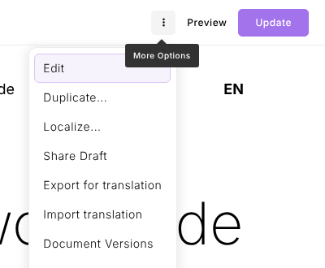
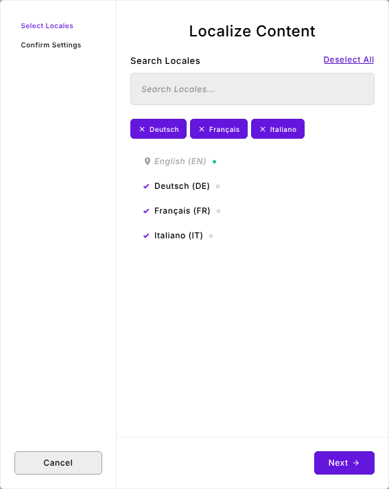
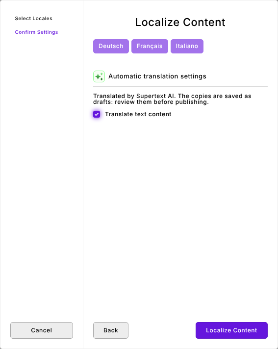
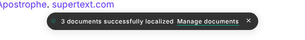
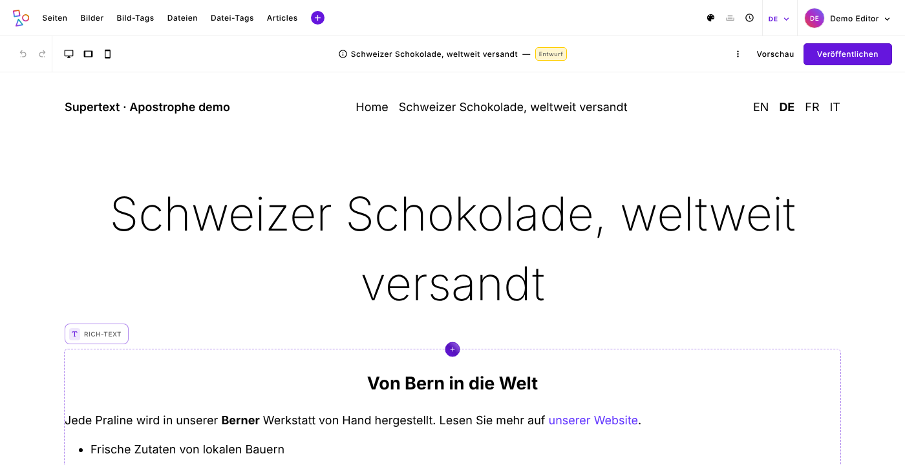
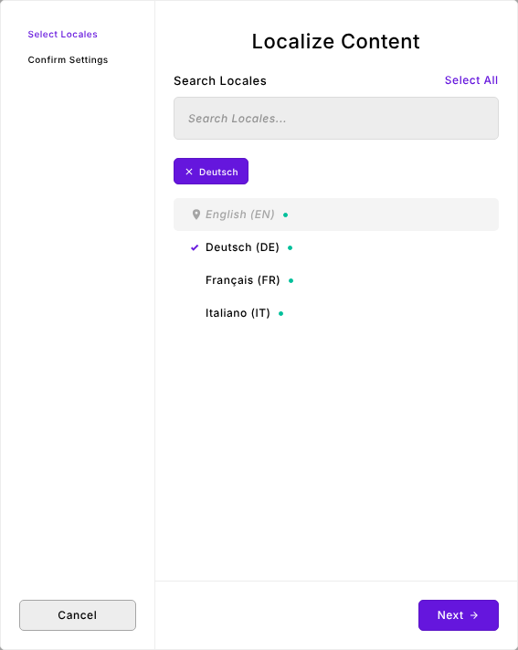

# User guide

For editors: how to translate pages and pieces with Supertext in ApostropheCMS, how to review the result, and what the messages mean. Administrators: see the [installation guide](INSTALLATION.md).

Supertext works inside Apostrophe's own **Localize…** step: when the module is set up, the *Localize…* wizard has a **Translate text content** option, and the copies it creates in other languages are translated by Supertext AI. To have a document translated outside Apostrophe instead (a translation tool, a translator, Supertext's web app), use **Export for translation** and **Import translation** in the same menu (see [Translate with a file](#translate-with-a-file-xliff-or-html)).

## Translate a page or piece

1. Open the page (or the piece, e.g. an article) in the language you wrote it in, usually English. Save your changes first: Supertext translates the saved draft.
2. Open the **More Options** menu (⋮) in the admin bar (on a piece: in the editor's menu, or in the list) and choose **Localize…**.

   

3. Select the locales to translate into, or **Select All**. A filled dot next to a locale means the document already exists there.

   

4. Click **Next**. Under *Automatic translation settings*, tick **Translate text content**. (If you leave it unticked, Apostrophe copies the content without translating it, as usual.)

   

   If the page has related documents (images, linked pieces), Apostrophe's usual options for them appear here as well; related documents that Apostrophe localizes are translated too.

5. Click **Localize Content**. Translating takes a few seconds per language. When it's done, Apostrophe confirms it:

   

You can also translate several pieces at once: select them in the list, choose **Localize** from the batch actions, and tick *Translate text content* in the same way.

## Translate with a file (XLIFF or HTML)

Instead of translating with *Localize…*, you can download a document's texts as a file, have them translated anywhere, and import the translated file again. The file contains exactly the texts *Translate text content* would send (see [What is translated](#what-is-translated)).

### Export for translation

1. Open the page or piece in its source language, save your changes, and choose **Export for translation** in the **More Options** menu (⋮), next to *Localize…*.
2. Choose the **File format**:
   - **XLIFF 1.2 (for translation tools)**: the standard format of translation tools such as Trados, memoQ or Phrase, and the better choice for them. Formatting (bold, links …) appears as protected tags. One file can hold several target languages.
   - **HTML (one language per file)**: for Supertext's web app or anyone who translates HTML. Choose exactly one target language.
3. Tick the **Target languages** and click **Download file**. The file is called `apostrophe-<document id>-<locale>.xlf` (or `.html`; `apostrophe-<document id>.xlf` for several languages).

If the document has no text to translate, the dialog says *Nothing to translate.* and no file is downloaded.

Send the file to your translator, open it in your translation tool, or upload it to Supertext's web app. Whoever translates an **HTML** file must leave its head (the `supertext:` lines) and the `data-st-id` attributes alone, and only translate the text. An HTML file has no way to mark a text as untranslated: imported unchanged, it writes the source text into the target language.

### Import translation

1. Choose **Import translation** in the **More Options** menu of any page or piece (the file itself says which document and language it belongs to).
2. Choose the **Translated file (XLIFF or HTML)** (at most 10 MB).
3. Optionally tick:
   - **Also import texts whose source changed since the export**: texts edited in the source after the export are skipped by default, because their translation may no longer fit.
   - **Replace the draft where the document already exists in the target locale**: without it, a document that already exists in the target locale is left alone (like the `translate` task without `--overwrite`).
4. Click **Import translation**.

The translations are saved exactly like a translation from *Localize…*: as a **draft** in the target locale (a new localization gets a translated URL), structure and formatting from the current source. Review and publish them as described [below](#review-and-publish). Texts that aren't imported keep the source text in the new draft.

The summary lists each document and language in the file:

| Line | Meaning |
| --- | --- |
| *Imported: n* | Texts written into the draft. |
| *Skipped, source changed since the export: n* | The source text was edited after the export. Tick *Also import texts whose source changed since the export* to import them anyway, or export again. |
| *Not translated in the file: n* | The file has no translation for these texts (XLIFF only). |
| *Formatting changed, not imported: n* | The translation broke, removed or added formatting (tags) the source doesn't have. Fix it in the translation tool and import again. |
| *Not in the file: n* | Texts added to the document after the export. Export again to translate them. |

| Message | Meaning |
| --- | --- |
| *This file isn't a valid XLIFF or HTML translation file.* | The file is damaged, not XLIFF or HTML, or not well-formed. |
| *This file wasn't exported by the Supertext plugin, or its header was removed.* | Use a file from *Export for translation*; for HTML, keep its head. |
| *The file is too large (at most 10 MB).* | Split the work into several exports. |
| *This file belongs to another system (…).* | The file was exported by another Supertext plugin (e.g. from another CMS). |
| *The document this file was exported from no longer exists.* | It was deleted (or you may not see it). |
| *The site has no language ….* | The file's source or target locale isn't one of this site's locales (any more). |
| *Not imported: the document already exists in ….* | Tick *Replace the draft where the document already exists in the target locale*. |
| *You may not change this document in ….* | You need permission to edit the document (Apostrophe's own permissions). |

## Review and publish

The translations are saved as **drafts** in each locale; nothing is published automatically. Switch to the locale (the language menu in the admin bar, or the language links on the site), open the page and review it:

Edit anything you like, then **Publish** (or **Submit** if you are a contributor). A new localization also gets a translated URL, made from the translated title (e.g. `/de/schweizer-schokolade-weltweit-versandt`); you can change it in the page settings like any slug.

## Translate again

Localizing into a locale where the document already exists **replaces that draft** with a new copy of the source, translated again. Apostrophe doesn't ask for confirmation: the filled dot in the locale list is the only sign that a version exists.

Unpublished changes you made in the translated draft are lost; the published version stays as it is until you publish again. The URL of an existing localization is kept.

## What is translated

- The **title** and other text fields (including multi-line text fields such as summaries).
- **Rich text**: each paragraph, heading, list item, quote and table cell is translated as a whole, with bold, italics and links kept in place. Link targets are not changed.
- Text fields of **other widgets** (for example a heading or caption field of your site's own widgets) and of **arrays and object fields**, at any depth, including widgets in layout columns.
- The **URL slug** of a new localization (see above).

## What is not translated

- Choices, dates, numbers, links (URL fields), e-mail fields, colors, tags and relationships: these are copied as they are.
- **HTML widgets** (raw code) and any widget type your administrator excluded.
- Fields your developers marked as not translatable (`translate: false`), e.g. product codes.
- Images and files themselves. Their own titles and alt texts are translated when Apostrophe localizes them as related documents with *Translate text content* ticked.
- Text that is part of the site's templates (header, footer, buttons): that is translated by your developers, not in the content.

## Messages

Messages appear in your interface language (English, German, French or Italian).

| Message | Meaning |
| --- | --- |
| *Supertext could not translate "…" into …: Supertext rejected the API key. Please check it.* | The site's Supertext API key is wrong or missing. Ask your administrator. |
| *… The locale … has no Supertext language. Ask your administrator to choose one …* | Supertext doesn't know which language variant to use for this locale (e.g. Irish English or Liechtenstein German), so nothing was sent. Your administrator chooses it in the admin bar under **Supertext → Languages**. Locales such as `de`, `fr` or `en` work without that (they use `de-DE`, `fr-FR`, `en-US` unless your administrator chose another variant). Apostrophe's *Localize…* wizard also says when automatic translation isn't available for a locale. |
| *… Supertext offers no formal or informal address for …* | A form of address was configured for a language that has none at Supertext. Ask your administrator (Supertext → Languages). |
| *… Supertext doesn't translate this language pair (…)* | The Supertext language set for the locale isn't one Supertext offers. Ask your administrator. |
| *… Too many requests to Supertext. Please try again in a moment.* | Supertext is busy with your account's requests. Wait a moment and localize again, into fewer languages at once. |
| *… Your Supertext translation quota is used up.* | The Supertext account's quota is used up. Ask your administrator. |
| *… The translation took too long.* | The document is very long. Try again later or ask your administrator to raise the time limit. |
| *… Supertext couldn't be reached: …* | The site can't connect to Supertext right now. Try again later. |
| No *Translate text content* option in the wizard | The module isn't set up (no API key). Ask your administrator. |

When translating into one language fails, the other languages are still translated. Apostrophe then shows a report of the locales that failed; those get no new copy. Localize into them again once the problem is solved.
